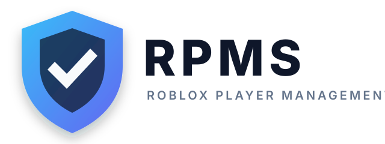

<div align="center">
  

  # RPMS

  **Roleplay Management System**

  Open-source staff, session, moderation, and activity management for Roblox communities.

  <p>
    <a href="https://github.com/Marcel1kub1/RPMS/actions/workflows/build.yml"></a>
    <a href="https://github.com/Marcel1kub1/RPMS/blob/main/LICENSE"></a>
    <a href="https://github.com/Marcel1kub1/RPMS/stargazers"></a>
    <a href="https://github.com/Marcel1kub1/RPMS/issues"></a>
  </p>

  <a href="#quick-start">Quick start</a> ·
  <a href="#features">Features</a> ·
  <a href="#configuration">Configuration</a> ·
  <a href="./docs/SETUP.md">Full setup guide</a> ·
  <a href="#contributing">Contributing</a>
</div>

## What is RPMS?

RPMS gives Roblox group owners and staff teams one place to manage people, activity, sessions,
moderation, documentation, and policies. It is designed to be self-hostable and lightweight,
with a Docker profile suitable for a small one-vCPU server.

> RPMS is derived from the upstream Orbit project and remains licensed under GPLv3. See
> [LICENSE](./LICENSE) and [NOTICE](./NOTICE) for attribution and redistribution requirements.

## Features

| Area | Included |
| --- | --- |
| **Staff management** | Roles, permissions, member administration, moderation history, and Roblox rank synchronization |
| **Automatic sessions** | A session starts when any tracked player joins a Roblox server and is labeled `staff` or `non_staff` |
| **Session reporting** | Activity duration, idle time, chat logs, server/job metadata, and reliable session closing |
| **Discord integration** | Discord OAuth2 login plus optional webhook events for joins, leaves, shifts, chat logs, and moderation |
| **Roblox integration** | Roblox OAuth login/linking and Roblox group activity integration |
| **Privacy controls** | Privacy policy, Impressum and terms pages, plus an authenticated automatic data-deletion request endpoint |
| **Operations** | MySQL 8, Prisma migrations, Docker deployment, audit logging, policies, documents, quotas, and notices |

## Quick start

### Docker

```bash
cp .env.example .env
# Set SESSION_SECRET, OAuth credentials, and strong MySQL passwords in .env
docker compose up --build -d
```

Open `http://localhost:3000` after the container is healthy.

The included compose profile is tuned for approximately **1 vCPU / 512 MB RAM / 8 GB storage**:
the application is limited to 384 MB and MySQL to 128 MB. For larger communities, use an
external MySQL service and increase the application resources.

### Development

```bash
corepack enable
pnpm install
cp .env.example .env
pnpm prisma generate
pnpm dev
```

### Clone-and-start hosting panels

If your hosting panel clones the repository and does not permit a build step, install dependencies
with `npm install --omit=dev --no-audit --no-fund --maxsockets=1`, then set the Node startup file
to `start.cjs`. Do not set `start.sh` as a Node startup file: WispByte will try to parse it as
JavaScript and report `ERR_UNKNOWN_FILE_EXTENSION`. `start.cjs` binds the web server to
`0.0.0.0:9050` by default and uses the host-provided `PORT` when available:

```bash
sh start.sh
```

This source-only mode uses `next dev`, because `next start` requires a generated `.next`
production build. It is suitable for restricted hosting panels but is not equivalent to a
production build: expect higher resource usage, disable development mode when possible, and
put the app behind your host's HTTPS reverse proxy. Configure your subdomain to proxy to
`127.0.0.1:9050` (or the host-provided port), and set `NEXTAUTH_URL`/`PUBLIC_URL` to the
public HTTPS subdomain.

To configure the environment interactively on the server, run:

```bash
sh setup-env.sh
```

The script masks secret input, writes `.env` with file mode `600`, and generates the OAuth
callback URLs for `https://rtmp.freesrv.com`. Never paste production secrets into chat or commit
the generated `.env` file.

Useful checks:

```bash
pnpm run lint
pnpm run format:check
pnpm run typecheck
pnpm run build
```

## Configuration

The complete example is in [.env.example](./.env.example). Required production configuration
includes:

- `SESSION_SECRET` — a long, random secret.
- `DATABASE_URL` or the `MYSQL_*` variables — MySQL 8 connection details.
- Discord OAuth credentials and callback URL.
- Roblox OAuth credentials and callback URL.
- `DISCORD_WEBHOOK_URL` and `DISCORD_WEBHOOK_ENABLED=true` to enable webhooks.

For this deployment, use `https://rtmp.freesrv.com` as the public URL and proxy that subdomain
to the host application port `9050`.

Never commit `.env`, OAuth secrets, webhook URLs, database passwords, or private keys.

For the complete Discord OAuth2, Roblox OAuth2, MySQL, domain, webhook, and security setup,
read the [full configuration guide](./docs/SETUP.md).

## Public legal pages

RPMS exposes:

- `/impressum`
- `/privacy`
- `/terms`

These are safe starting templates, not legal advice. Replace them with operator-specific,
reviewed text before public deployment. Authenticated users can request deletion through
`POST /api/privacy/delete-request`.

## Project widgets

<div align="center">
  <a href="https://github.com/Marcel1kub1/RPMS/issues/new?template=bug_report.md">🐛 Report a bug</a> ·
  <a href="https://github.com/Marcel1kub1/RPMS/issues/new?template=feature_request.md">✨ Request a feature</a> ·
  <a href="https://github.com/Marcel1kub1/RPMS/discussions">💬 Discussions</a> ·
  <a href="https://github.com/Marcel1kub1/RPMS/releases">📦 Releases</a>
</div>

## Contributing

Pull requests and focused issue reports are welcome. Read
[CONTRIBUTING.md](./.github/CONTRIBUTING.md) before opening a change. Please do not include
credentials, private player data, webhook URLs, or production database dumps.

## License

RPMS is distributed under the [GNU General Public License v3.0](./LICENSE). You may use,
modify, and redistribute it under the license terms, including commercially, provided that
the GPL obligations are met.

<div align="center">
  <sub>RPMS is an independent open-source project by Marcel Bender.</sub>
</div>
